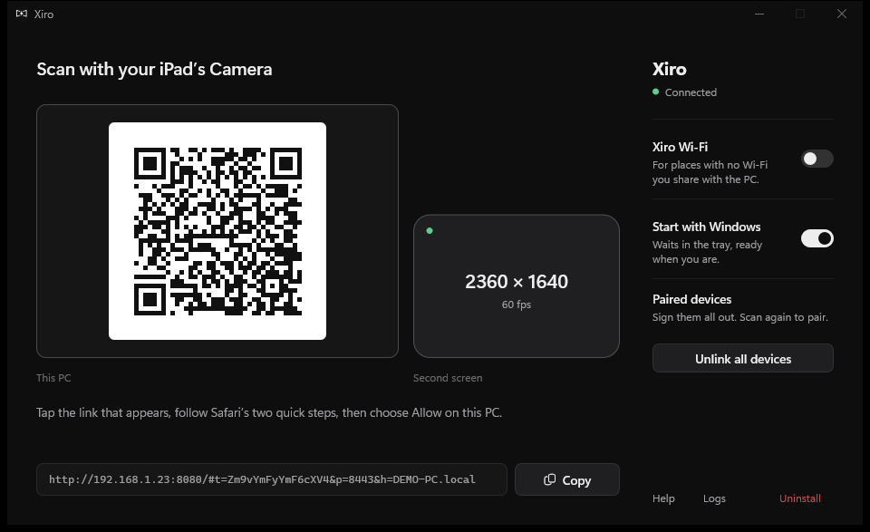
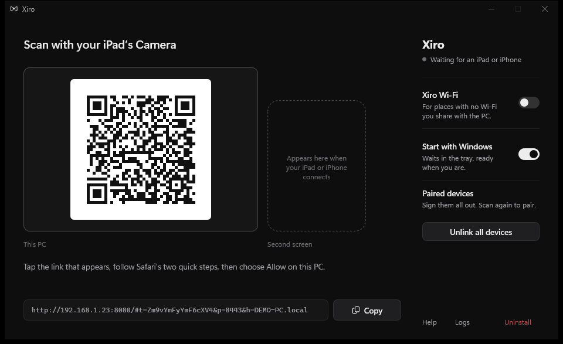
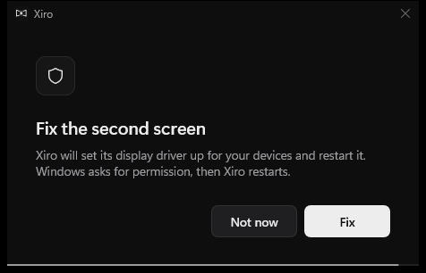

<div align="center">


# Xiro

**Your iPad or iPhone as a real second screen for Windows.**

[](https://github.com/Icetist/Xiro/releases/latest)
[](https://github.com/Icetist/Xiro/releases)
[](https://github.com/Icetist/Xiro/actions/workflows/release.yml)


[Features](#-features) •
[Screenshots](#-screenshots) •
[Installation](#-installation) •
[Usage](#️-usage) •
[Configuration](#️-configuration) •
[Building](#️-building-from-source) •
[FAQ](#-faq)



</div>

Xiro turns an iPad or iPhone into an extended monitor for your PC, the way Sidecar does on a Mac. On the PC it is one portable `Xiro.exe` written in Rust; on the device it is just a page in Safari. No app to install on the device, no account, no cloud, and it costs nothing.

<p align="center"><sub>If Xiro gives you a second screen you didn't have to buy, consider leaving a ⭐. It genuinely helps.</sub></p>

## ✨ Features

- **A real second monitor.** Windows sees a display shaped exactly like your device. It appears when the device connects, rotates when you rotate it, and disappears when you're done, moving its windows back to your main screen.
- **Low latency end to end.** Capture, colour conversion and H.264 encoding all happen on the GPU with one frame in flight; the device decodes in hardware straight to the screen. No video element, no buffering.
- **Real input.** Multi-touch arrives as Windows touch, Apple Pencil as a Windows Ink pen with pressure and tilt, plus keyboard, trackpad and mouse.
- **Any PC.** Windows 10 or 11, new or old. NVIDIA, AMD and Intel hardware encoders, with a software encoder as a fallback. Xiro measures what your PC sustains and never lets lag build up.
- **Portable.** One small `Xiro.exe` that carries its own display driver and sets it up with a single Windows permission prompt. No installer, no runtime.
- **Anywhere.** Same Wi-Fi, a cable, or **Xiro Wi-Fi**: the PC's own private network for places with no Wi-Fi you share.
- **Private.** Pairing needs a one-time code and a Yes on the PC; everything is encrypted with a certificate made on your PC. Nothing ever leaves your network.

## 📸 Screenshots

<table>
  <tr>
    <td width="50%"></td>
    <td width="50%"></td>
  </tr>
  <tr>
    <td align="center"><b>Scan to connect</b></td>
    <td align="center"><b>Xiro Wi-Fi, for anywhere</b></td>
  </tr>
  <tr>
    <td width="50%"></td>
    <td width="50%"></td>
  </tr>
  <tr>
    <td align="center"><b>Connected, at the iPad's own resolution</b></td>
    <td align="center"><b>One click to set up or fix the display</b></td>
  </tr>
</table>

## ⚡ Performance

Measured on a 2014 laptop (Intel HD Graphics with Quick Sync) while other apps kept the CPU busy:

| | Result |
| --- | --- |
| **Encoding at 1180×820** | 60 fps, about 9 ms per frame |
| **Encoding at 2360×1640** (iPad Air) | 35–55 fps |
| **Capture to network on the PC** (median) | 8–16 ms, encoding included |
| **First connection ever** (one-time encoder test) | about 11 s |
| **Reconnecting** | 0.1 s within 15 s, about 1.3 s after that |

A recent dedicated GPU encodes a frame in a few milliseconds. The network matters most: a cable beats Xiro Wi-Fi, which beats a busy router.

## 📦 Installation

1. Download **`Xiro.exe`** from the [latest release](https://github.com/Icetist/Xiro/releases/latest).
2. Put it anywhere and run it. Xiro offers to **set up the second screen**; Windows asks for permission once, to add the display driver and a firewall rule for your local network.
3. On your iPad or iPhone, scan the code in Xiro's window with the Camera and follow Safari's two quick steps. Then choose **Allow** on the PC.
4. In Safari, tap **Share → Add to Home Screen**. From that icon Xiro runs full screen and reconnects with one tap.

**Requirements:** Windows 10 (2004 or newer) or Windows 11, and iPadOS / iOS 16.4 or newer.

> [!NOTE]
> Safari only decodes video in hardware on secure pages, so the first connection installs a certificate made on your PC. Before tapping Install, check that the fingerprint under **More Details** matches the one in Xiro's **Help** page.

## 🖱️ Usage

- **Connect:** open the Xiro icon on the device, or scan the code again. The second screen appears in **Settings → System → Display**, where you can move it like any monitor; Xiro remembers where.
- **Touch, Pencil and keys:** fingers work as touch (or as a mouse, from the on-screen toolbar), Apple Pencil as a pen, and ⌘ acts as Ctrl.
- **No shared Wi-Fi?** Switch on **Xiro Wi-Fi** in the window. The code becomes two steps: join the network, then open Xiro. It is always off when Xiro starts.
- **A cable:** on cellular iPads and iPhones, turn on **Personal Hotspot** with the cable plugged in (Windows needs the Apple Devices app for this). USB-C iPads also take a USB-C Ethernet adapter.
- **Unlink:** **Unlink all devices** signs every device out at once. On a device, remove the profile under **Settings → General → VPN & Device Management → Xiro Local CA**.
- **Uninstall:** **Uninstall** in the window removes the display driver, the firewall rule and Xiro's settings. Then delete `Xiro.exe`.

## ⚙️ Configuration

Settings live in `%LOCALAPPDATA%\Xiro\config.json`:

| Key | Default | Description |
| --- | --- | --- |
| `fps` | `"auto"` | Frame-rate cap |
| `bitrateMbps` | `null` | Bitrate; automatic scales with resolution |
| `encoder` | `"auto"` | `"auto"`, `"hardware"`, `"software"`, or part of an encoder's name |
| `display` | `"auto"` | `"auto"` for the device-shaped monitor, or a 1-based index / `\\.\DISPLAYn` to stream an existing one |
| `gopSeconds` | `1` | Key-frame interval; shorter recovers faster after Wi-Fi drops |
| `cmdAsCtrl` | `true` | Map ⌘ to Ctrl |
| `httpsPort` / `httpPort` | `8443` / `8080` | Viewer and setup ports |

`Xiro.exe --help` lists the command-line options, including `--console`, `--pair`, `--new-token`, `--list-displays` and `--uninstall`. Logs are in `%LOCALAPPDATA%\Xiro\xiro.log` (window → **Logs**).

## 🛠️ Building from source

**Requirements:** Rust (stable, MSVC toolchain) and Node 22+ for the client tests.

```powershell
powershell -File scripts\fetch-driver.ps1   # the display driver package, checksum verified
cargo build --release                        # target\release\xiro.exe
cargo test --workspace
npm test
```

The GNU toolchain works too: `.cargo/config.toml` links with Rust's bundled `rust-lld`, and `tools/gnu-dlltool` stands in for MSYS2's `dlltool`. Icons come from `logo/logo.png` via `python scripts/make-icons.py`.

| Folder | What it holds |
| --- | --- |
| `src/` | The app: startup, window flows, the HTTPS/WebSocket server, sessions |
| `crates/xiro-video` | Desktop capture, GPU colour conversion, H.264 encoding |
| `crates/xiro-display` | The on-demand virtual monitor and its driver |
| `crates/xiro-input` | Touch, pen, mouse and keyboard injection |
| `crates/xiro-net` | The local certificate authority and TLS |
| `crates/xiro-shell` | Tray icon, window and dialogs (Direct2D), firewall rule |
| `crates/xiro-hotspot` | Xiro Wi-Fi |
| `web/` | The page served to the device |

## ❓ FAQ

<details>
<summary><b>Why does my device show my PC's screen instead of extending it?</b></summary>

The display driver isn't running, so Xiro mirrors your main screen. Click **Fix** in Xiro's window and allow the Windows prompt; Xiro restarts with the second screen working.

</details>

<details>
<summary><b>The device can't open the page.</b></summary>

PC and device must be on the same network, and some networks keep devices apart. Switch on **Xiro Wi-Fi**, or allow Xiro when Windows Firewall asks.

</details>

<details>
<summary><b>Xiro Wi-Fi won't start, or the device can't join it.</b></summary>

Turn Wi-Fi on and turn off Windows' **Mobile hotspot** and any wireless display (Win+K), which share the adapter. Xiro Wi-Fi uses the same channel as the PC's current network; on older 2.4 GHz-only cards some devices refuse channels 12 and 13, so the shared Wi-Fi is the better choice there.

</details>

<details>
<summary><b>Can I use a plain USB cable?</b></summary>

Only with a cellular iPad or an iPhone, through Personal Hotspot. A Wi-Fi-only iPad has no network over USB; use a USB Ethernet adapter on the iPad instead.

</details>

<details>
<summary><b>Is it safe on public Wi-Fi?</b></summary>

Paired devices are: everything is encrypted with your PC's own certificate, which can't vouch for public websites. For the first pairing, use Xiro Wi-Fi so only someone with its password can reach the PC. Every new device also needs a Yes on the PC.

</details>

<details>
<summary><b>Touch doesn't work in one app.</b></summary>

Windows blocks injected input into apps running as administrator.

</details>

<details>
<summary><b>Windows warns about the download.</b></summary>

Releases are signed through SignPath Foundation once the project is accepted; until then Windows may show a SmartScreen warning. Compare the file with `Xiro.exe.sha256` from the same release.

</details>

## 🔒 Security

- The QR code holds a **one-time pairing code** that expires after 15 minutes; it is traded over TLS for the real token, which never travels in plain text.
- **Every new device needs a Yes on the PC**, and No is the default.
- The certificate authority Xiro makes is **name-constrained** to private addresses and local names, so even a stolen key can't impersonate a website.
- One device controls the PC at a time; held keys and touches are released when it leaves, and the PC shows a notification whenever a device takes control.
- The firewall rule only admits your local subnet, on Xiro's own ports.

## 🙏 Credits

- [Virtual Display Driver](https://github.com/VirtualDrivers/Virtual-Display-Driver) by the VirtualDrivers contributors, licensed under the MIT License, bundled in `Xiro.exe`.
- [qrcodegen](https://github.com/nayuki/QR-Code-generator) by Project Nayuki, licensed under the MIT License.

## 📜 Code signing policy

Free code signing provided by [SignPath.io](https://about.signpath.io), certificate by [SignPath Foundation](https://signpath.org). Every release is built from this repository by GitHub Actions ([release.yml](.github/workflows/release.yml)) and signed only after the maintainer approves it.

- Committers, reviewers and approvers: the repository owner

## 🛡️ Privacy

Xiro does not transfer any information to other networked systems unless specifically requested by the user. It never contacts the internet: the PC talks only to the devices you pair with it. There is no account, analytics or telemetry; settings, pairing data and logs stay in `%LOCALAPPDATA%\Xiro`.

## 📄 License

[MIT](LICENSE).

---
